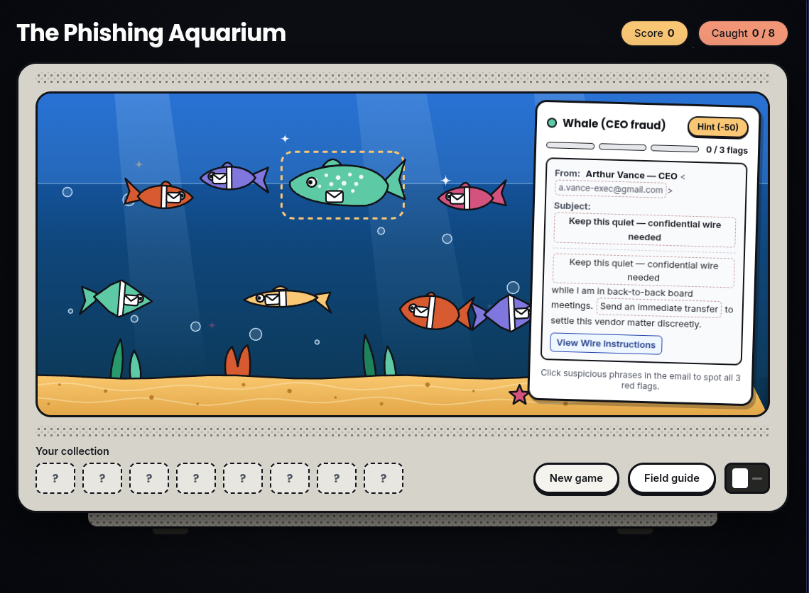

# The Phishing Aquarium

A tank full of swimming "emails". Spot the red flags, catch the phish, and fill your collection.



> Replace `docs/screenshot.png` with a screenshot of the game (create a `docs/` folder and drop the image in).

**Play it live:** https://abinethra.github.io/phishing-aquarium/

---

## Features

- A retro tabletop-aquarium look with bold outlines, sun rays, sparkles and a sandy seabed
- 8 phishing "species", each a swimming fish with its own colour, shape and sample email
- Click a fish to open its email and hunt for 3 hidden red flags (sender, urgency, link and more)
- Score system with bonuses for speed and clean catches, and penalties for wrong clicks and hints
- A collection page with sticker-style cards and a field-guide entry for every species you catch
- A "Tank Cleared" results screen with a rank title
- Progress saved in your browser, no accounts or sign-ups
- Responsive layout (works down to 360px wide), keyboard accessible, and respects reduced-motion settings

## How to play

1. Click a fish swimming in the tank to open its email in the inspector.
2. Read the email carefully and click the 3 red flags hidden in the text (a mismatched sender, fake urgency, a suspicious link and so on).
3. Each correct flag shows a short explanation. A wrong click costs points.
4. Find all 3 flags to catch the fish. It joins your collection.
5. Stuck? Use a hint, but it costs points.
6. Catch all 8 species to clear the tank and earn your rank.

Open the **Field guide** from the collection page to read how each phishing type works and how to spot it.

## Tech stack

- Vanilla HTML, CSS and JavaScript (no frameworks, no build step)
- HTML Canvas for the animated tank
- `localStorage` for saving progress
- JSON for the species data
- GitHub Pages for hosting

## Project structure

```
phishing-aquarium/
├── index.html          # The game
├── collection.html     # Collection and field guide
├── css/
│   └── style.css       # Design system and styles
├── js/
│   ├── tank.js         # Canvas drawing and fish animation
│   ├── game.js         # Game logic: inspecting, flags, scoring
│   └── storage.js      # localStorage save and load
├── data/
│   └── phish.json      # The phishing species
├── docs/
│   └── screenshot.png  # README screenshot
├── LICENSE
├── .gitignore
└── README.md
```

## Run locally

**Option 1: just open it.** Double-click `index.html`. Some browsers block loading `data/phish.json` from a `file://` page, so if the tank is empty, use option 2.

**Option 2: a simple local server** (recommended):

```bash
# Python 3
python -m http.server 8000
```

Then visit http://localhost:8000.

Or with Node:

```bash
npx serve .
```

## Add a new phishing species

All species live in `data/phish.json`. To add one, append an object to the list:

```json
{
  "id": "gift-card-guppy",
  "name": "Gift Card Guppy",
  "type": "Gift card scam",
  "colour": "#FFD23F",
  "shape": "round",
  "difficulty": 2,
  "email": {
    "fromName": "Your Manager",
    "fromAddress": "boss.office@gmail.com",
    "subject": "Quick favour, are you free?",
    "body": "I'm in a meeting and need 5 gift cards for clients. Buy them now and send me the codes.",
    "linkText": "",
    "linkRealUrl": ""
  },
  "redFlags": [
    { "id": "f1", "kind": "sender", "text": "boss.office@gmail.com", "explanation": "A real manager would write from the company address, not a free email account." },
    { "id": "f2", "kind": "request", "text": "Buy them now and send me the codes", "explanation": "Asking for gift card codes is a classic scam request." },
    { "id": "f3", "kind": "urgency", "text": "I'm in a meeting", "explanation": "The excuse for why they can't talk is there to stop you from checking." }
  ],
  "fieldGuide": {
    "howItWorks": "The scammer pretends to be someone you trust and asks for gift cards, which are hard to trace.",
    "howToSpot": ["Unusual request from a boss", "Free email address", "Pressure to act quickly"],
    "whatToDo": "Don't reply. Call the person on a number you already have and report the email."
  }
}
```

Rules to keep it working:

- Every `redFlags[].text` must appear **word for word** inside the email, so the game can highlight it.
- Use exactly 3 red flags per species.
- `shape` is one of `classic`, `long`, `round` or `spiky`.
- If you go beyond 8 species, update the "Caught X / 8" total and the collection grid.

## What I learned about phishing

- **The sender name can lie, the address can't.** Scammers fake the display name, but the actual address often has a small giveaway like `paypa1` with a number one, or a free email account pretending to be a company.
- **Urgency is a weapon.** "Your account will be locked in 24 hours" is meant to make you act before you think.
- **Always check where a link really goes.** The text can say one thing while the URL points somewhere else. Hovering over a link reveals the real address.
- **Generic greetings are a clue.** "Dear customer" usually means a mass email, while targeted attacks (spear phishing) use your real name and details.
- **Targeted attacks are harder to spot.** Spear phishing and CEO fraud (whaling) use real names and believable situations, so the red flags are subtler.
- **Unusual requests are the biggest flag of all.** Gift cards, urgent payments, password resets you didn't ask for, and "keep this secret" are all signs to stop and verify another way.
- **The fix is simple.** Don't click. Open the real website yourself or call the person on a number you already have, then report the email.

## Licence

This project is licensed under the MIT Licence. See the [LICENSE](LICENSE) file for details.